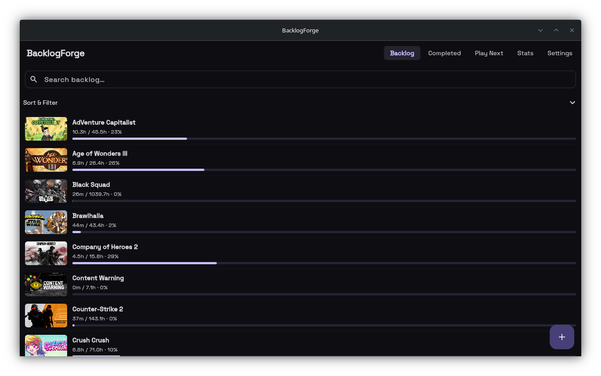
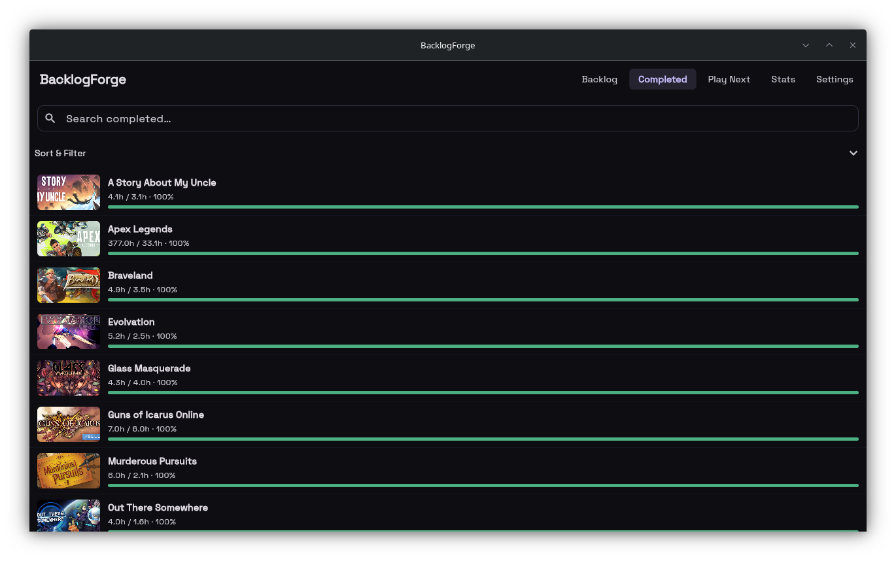
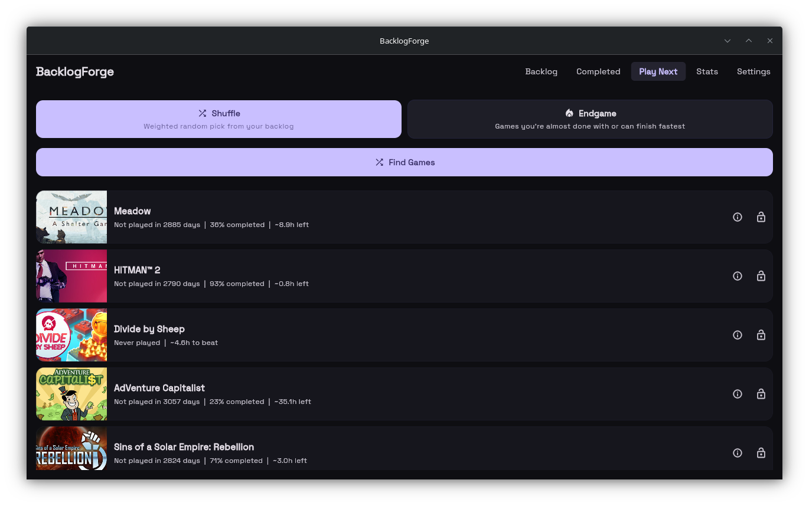
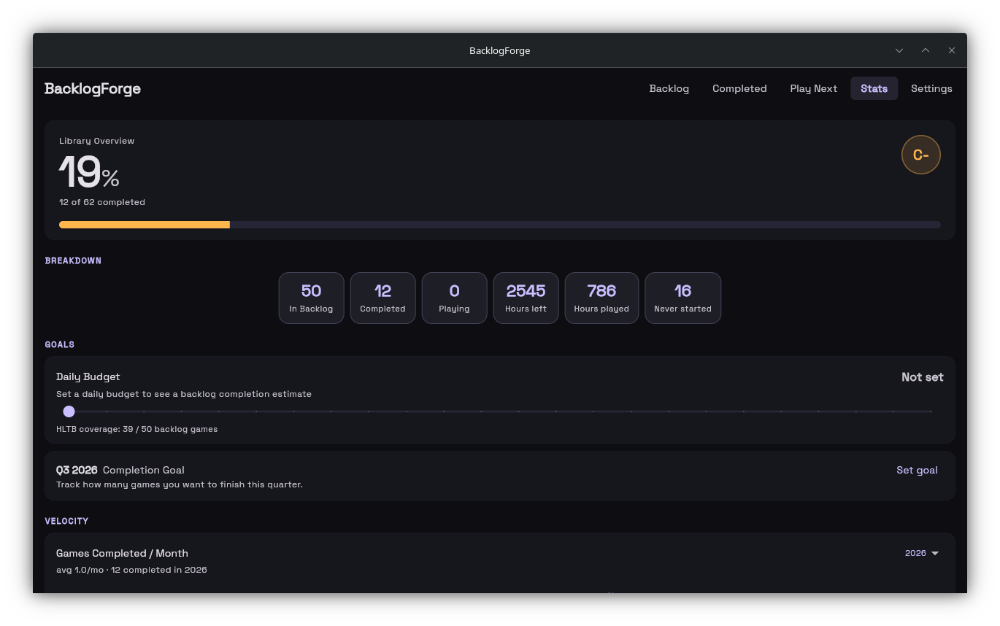

# BacklogForge

<p align="center">
  
</p>

<p align="center">
  <strong>Know what to play. Actually finish it.</strong><br/>
</p>

<p align="center">
  <a href="https://github.com/ajwadtahmid/backlog-forge/releases">
    
  </a>
  <a href="https://github.com/ajwadtahmid/backlog-forge/releases">
    
  </a>
  <a href="https://flutter.dev">
    
  </a>
  <a href="https://github.com/ajwadtahmid/backlog-forge/blob/main/LICENSE">
    
  </a>
  
  
  
</p>

---

<div align="center">

<a href="https://github.com/ajwadtahmid/backlog-forge/releases">
</a>

<a href="https://play.google.com/store/apps/details?id=com.ajwadtahmid.backlogforge">
</a>

<a href="https://apps.apple.com/app/id">
</a>

</div>

---

## Overview

BacklogForge connects to your Steam account, imports your game library, and helps you decide what to play next. It pulls completion time estimates from HowLongToBeat and compares them against your actual playtime to automatically track which games you have finished, which are in progress, and which are still sitting in your backlog.

Designed for PC gamers who own large Steam libraries and want a structured, low-friction way to manage them — no spreadsheets, no third-party accounts, all data stored locally.

## Table of Contents

- [Key Features](#key-features)
- [Screenshots](#screenshots)
- [Features](#features)
- [Downloads](#downloads)
- [Development](#development)
- [Data & Privacy](#data--privacy)
- [Support & Feedback](#support--feedback)
- [FAQ](#faq)
- [Known Limitations](#known-limitations)
- [Credits & Acknowledgments](#credits--acknowledgments)
- [License](#license)

---

### Key Features

- **Steam Library Sync** — Automatically imports your entire Steam library. BacklogForge fetches HowLongToBeat estimates for every title in the background with live sync progress, so your backlog is always up to date.

- **Automatic Completion Tracking** — Compares your actual playtime against HowLongToBeat targets to mark games as completed, in progress, or unstarted — no manual input needed. Supports Essential, Extended, and Completionist targets per game.

- **Play Next Recommendations** — Two modes to cut through decision paralysis: Shuffle picks a weighted random game from your backlog, while Homestretch surfaces games you're closest to finishing — either by percentage or fewest hours remaining.

- **Library Statistics** — A full stats dashboard with your completion grade (A+ → D-), hours remaining to clear your backlog, average finish time, monthly completion velocity, and a daily budget calculator showing how long until your backlog is clear.

- **Guest & Offline Mode** — No Steam account required. Use the app in guest mode and add games manually. All data is stored locally in SQLite with no cloud sync.

- **Per-Game Notes & Ratings** — Add personal notes and a 1–10 rating to any game. Export and import your full library (including notes and ratings) for backup or device transfer. Importing merges into the games you already have instead of replacing them, so your local notes and ratings are kept.

---

## Screenshots

| Backlog | Completed | Play Next | Stats |
|---------|-----------|-----------|-------|
|  |  |  |  |

---

## Features

- **Steam library sync** — imports all games from your Steam account automatically
- **Guest / offline mode** — use the app without a Steam account; add games manually
- **HowLongToBeat integration** — fetches Essential, Extended, and Completionist estimates per title straight from your device, matching games by Steam app ID where HLTB has the link
- **Sync progress feedback** — live counter shows HLTB fetch progress during sync
- **Automatic completion detection** — marks a game completed when playtime meets the target
- **Configurable play style** — choose Essential, Extended, or Completionist as your personal target per game
- **Manual status override** — set any game to Playing or Completed regardless of playtime
- **Play Next — Shuffle** — weighted random pick from your backlog with lockable picks
- **Play Next — Homestretch** — surface games closest to the finish line (by % or hours remaining)
- **Per-game notes & ratings** — add a 1–10 rating and freeform notes to any game
- **Finish-by projection** — estimates your finish date based on your daily gaming budget
- **Library statistics** — completion grade (A+ → D-), hours to clear backlog, avg. finish time, velocity chart
- **Daily budget calculator** — set hours per day and see when your backlog clears
- **Length filter** — filter backlog by game length (Short / Medium / Long / No Data)
- **Sort & search** — sort by playtime, HLTB estimate, alphabetically, or last played; full-text search
- **Manual game search** — add titles that are not in your Steam library
- **Background sync** — automatically re-syncs your library every 2 hours while the app is open
- **Export & import** — back up your full library (including notes, ratings, and manual games) as JSON, or export a CSV for a spreadsheet
- **Merge on import** — games already in your library are updated in place; notes, ratings, status overrides and dates are kept unless the backup has its own value, and out-of-range values in a file are ignored
- **Import dry-run preview** — see exactly which games will be added or merged before confirming
- **Dark by default** — new installs start in the dark theme; switch to light or follow the system in Settings, and the choice is remembered
- **Fonts** — Space Grotesk, Inter or JetBrains Mono (all bundled with the app), or the system font, chosen in Settings → Appearance
- **Large text and wide screens** — layouts adapt to a large system font size, to landscape, and to tablets and desktop windows
- **Offline-first** — all data stored locally in SQLite; no cloud sync required

---

## Development

### Requirements

| Tool | Version |
|------|---------|
| Flutter SDK | 3.50+ (stable channel) |
| Dart SDK | 3.14+ (bundled with Flutter) |
| Android: Java | 17 |
| Linux: GTK | `libgtk-3-dev` |
| Backend (optional) | Node.js 20+, only to deploy `backend/worker` |

### Quick Start

```bash
# 1. Clone
git clone https://github.com/ajwadtahmid/backlog-forge.git
cd backlog-forge

# 2. Install dependencies
flutter pub get

# 3. Copy environment file
cp .env.example .env

# 4. Update .env with your backend URL and token
# Edit .env and set BACKEND_URL and CLIENT_TOKEN (see Configuration below)

# 5. Generate database and env code
dart run build_runner build --delete-conflicting-outputs

# 6. Run
flutter run
```

### Configuration

The app uses a small backend for the two things that need a secret or an https URL: fetching your Steam library (the Steam API key stays on the server) and the Steam sign-in redirect. HowLongToBeat lookups do **not** go through it. The app queries howlongtobeat.com directly from your device.

```env
# .env
BACKEND_URL=https://your-backend-url.com
CLIENT_TOKEN=your-secret-token
```

The values are baked into the app at build time. After editing `.env`, regenerate (the `clean` step matters: without it a stale `BACKEND_URL` can stay compiled in):

```bash
dart run build_runner clean
dart run build_runner build --delete-conflicting-outputs
```

#### Backend

The hosted backend is a Cloudflare Worker at `backlog-forge-api.ajwad.dev` — no extra setup needed for standard use.

To self-host, deploy the Worker in [`backend/worker`](backend/worker) — its README has the full walkthrough. In short:

```bash
cd backend/worker
npm install
npx wrangler deploy
npx wrangler secret put STEAM_API_KEY   # Steam Web API key from steamcommunity.com/dev/apikey
npx wrangler secret put CLIENT_TOKEN    # shared secret matching CLIENT_TOKEN in your app's .env
```

Generate a secure token with:

```bash
openssl rand -hex 32
```

Then set `BACKEND_URL` and `CLIENT_TOKEN` in `.env` and regenerate as above.

### Releases

Pushing a tag of the form `vX.Y.Z` (for example `v1.2.0`) starts the release workflow: it runs `flutter analyze` and `flutter test`, and only if both pass builds the Android bundle, the Windows installer and the Linux AppImage. Tags with anything else in them (`v1.2.0-rc1`, `vtest`) do nothing, and there is no check on ordinary pushes or pull requests, so run `flutter analyze` and `flutter test` (see Testing below) before tagging.

### Testing

```bash
flutter analyze
flutter test                                     # unit tests, no network

# Opt-in checks against the real services:
HLTB_LIVE=1 flutter test test/live/hltb_live_test.dart

# Full sync on a COPY of an existing app database (your real one is never written):
E2E_DB=<path to backlogforge.db> E2E_STEAM_ID=<17-digit id> \
  flutter test test/live/e2e_sync_live_test.dart

cd backend/worker && npm test                    # Worker tests
```

## Data & Privacy

- **No login, no account.** Steam sign-in happens on Steam's own page; BacklogForge never sees your password.
- **Steam ID.** It is stored on your device and sent to the BacklogForge backend only to fetch your public game library from Steam. The backend does not store it.
- **HowLongToBeat.** Game titles are sent directly from your device to howlongtobeat.com to look up completion times, so HowLongToBeat sees your IP address like any website would. These requests do not pass through the BacklogForge backend.
- **Artwork.** Cover images are loaded directly from Steam's content delivery network (`cdn.akamai.steamstatic.com`) and from HowLongToBeat's image hosts, so those servers see your IP address and the game each image belongs to. Images are cached on the device after the first load.
- **Fonts.** Space Grotesk, Inter and JetBrains Mono are bundled with the app (SIL Open Font License); nothing is downloaded from Google Fonts.
- **No analytics or tracking.** The app contains no analytics, advertising or tracking SDKs.
- **Local-only storage.** All game data, notes, ratings, and settings are stored on-device in SQLite.

See the full [privacy policy](https://ajwadtahmid.github.io/privacy-policies/).

---

## Support & Feedback

Have a question or found a bug? Let us know:

- **Email**: [support@ajwadtahmid.com](mailto:support@ajwadtahmid.com)
- **Bug reports & features**: [GitHub Issues](https://github.com/ajwadtahmid/backlog-forge/issues)
- **Ideas & discussions**: [GitHub Discussions](https://github.com/ajwadtahmid/backlog-forge/discussions)

---

## Credits & Acknowledgments

Special thanks to:

- **[HowLongToBeat](https://howlongtobeat.com)** — Game completion time estimates that power the core tracking feature
- **[hltb-for-deck](https://github.com/morwy/hltb-for-deck)** — Steam Deck plugin whose approach to querying HowLongToBeat (cached endpoint discovery, Steam app ID matching) the app's on-device client follows
- **[Valve / Steam](https://store.steampowered.com)** — Steam Web API for importing game libraries and playtime data
- **[Claude Code](https://claude.ai/code)** — Parts of this project were built with the assistance of Claude

---

## FAQ

**Q: Is this app affiliated with Valve or Steam?**
No. BacklogForge is an unofficial fan project. It uses the public Steam Web API to read your owned games and playtime, but is not affiliated with or endorsed by Valve Corporation.

**Q: Do I need a Steam account?**
No. You can use guest mode and add games manually. A Steam account is only needed to import your library automatically.

**Q: Is my data stored in the cloud?**
No. All data — games, notes, ratings, settings — is stored locally in a SQLite database on your device. Your Steam ID is sent to the BacklogForge backend only to fetch your library from Steam and is not stored there. Game titles are sent straight from your device to HowLongToBeat to look up completion times.

**Q: How does automatic completion detection work?**
BacklogForge compares your Steam playtime against the HowLongToBeat estimate for your chosen play style (Essential, Extended, or Completionist). When your playtime meets or exceeds the target, the game is automatically marked as completed.

**Q: What platforms are supported?**
Android, Windows, and Linux.

**Q: Can I use it for non-Steam games?**
Yes. Use the manual search to find any game on HowLongToBeat and add it to your library.

---

## Known Limitations

- **Steam only** — automatic sync works with Steam libraries only; non-Steam games must be added manually
- **Public Steam profile required** — the app cannot import a private Steam library
- **HowLongToBeat coverage** — not every game has HLTB data; games without estimates still appear in your library but won't have completion targets or finish-by projections
- **HowLongToBeat matching** — games are matched by Steam app ID when HLTB links it; otherwise the closest title wins and may need correcting via *Update Time to Beat*
- **HowLongToBeat limits** — lookups run from your device and need access to howlongtobeat.com. If HLTB rate-limits you mid-sync, the remaining games are retried on the next sync rather than skipped
- **Background sync** — the 2-hour background sync only runs while the app is open; playtime changes when the app is closed are picked up on the next manual or automatic sync
- **Playtime source** — playtime is sourced from Steam and may differ slightly from in-game clocks
- **Importing a backup** — a game's notes in the file replace the notes you have locally for that game (blank notes never erase yours), so importing an old backup over newer notes can overwrite them

---

## License

[GNU General Public License v3.0](LICENSE)

---
